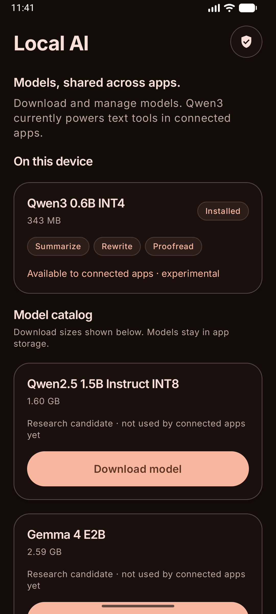
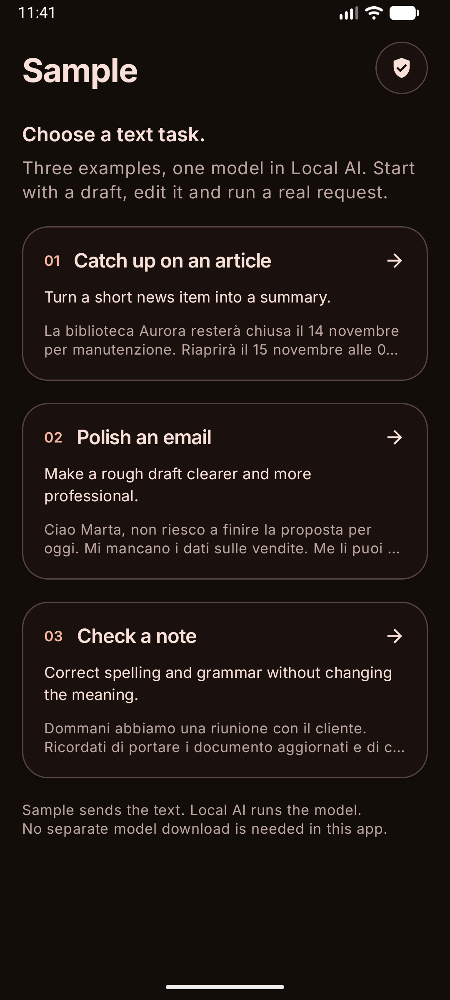
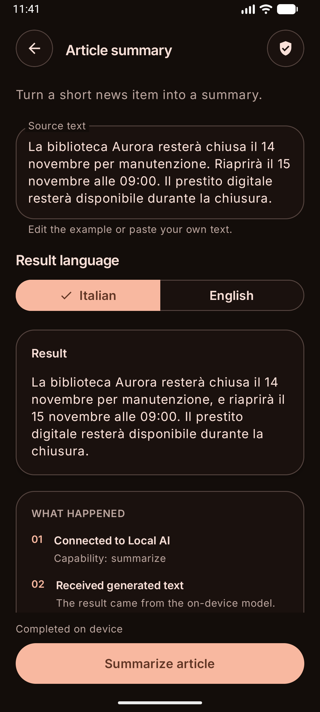

<p align="center">
  
</p>

# Local AI

[](#requirements)
[](#sdk-integration)
[](#models)
[](#limits)

On-device summarization, rewriting and proofreading for Android apps.
Local AI installs the model and runs inference in a bound service. Other apps
use a Kotlin SDK to send text requests and receive results through Binder.

[Get started](#get-started) · [SDK integration](#sdk-integration) ·
[Permission](#request-permission) · [Requests](#run-a-request) ·
[Models](#models) · [Limits](#limits) · [Sample app](#sample-app) ·
[Project structure](#project-structure) · [Building and testing](#building-and-testing)

## Get started

### Requirements

- Android 8.0 / API 26 or newer, with an ARM64 or x86-64 device or emulator.
- JDK 21 and Android SDK 37 to build. The apps target API 36.
- Space for the downloaded model; Qwen3 is about 343 MB. Runtime memory use is higher than file size.

Set `ANDROID_HOME` or `sdk.dir` in a local `local.properties` file, then build:

```sh
git clone https://github.com/lucf15/local-ai-services.git
cd local-ai-services
./gradlew :apps:local-ai:assembleDebug
adb install -r apps/local-ai/build/outputs/apk/debug/local-ai-debug.apk
```

1. Open **Local AI**.
2. Download **Qwen3 0.6B INT4**. It is the model currently used by the service.
3. Wait for **Installed**. The app verifies size and SHA-256 before activating it.
4. Open a client app and grant its local-AI permission when it first requests access.

Downloads default to unmetered connections. Change **Wi-Fi downloads** if you
want to allow a metered connection. Downloading needs internet access; inference
runs on the device.

Install **Local AI before the client app**. Local AI defines the runtime permission
that clients request. Installing the manager does not add tools to existing apps;
each client needs the SDK integration below.



## SDK integration

There is no Maven release yet. Within this checkout, add the SDK module:

```kotlin
dependencies {
    implementation(project(":libs:sdk"))
}
```

For another project, include `libs/sdk` as a source module or build its AAR:

```sh
./gradlew :libs:sdk:assembleRelease
```

The artifact is `libs/sdk/build/outputs/aar/sdk-release.aar`. It contains both the
Kotlin client and generated AIDL types. When using a raw AAR, also add
`org.jetbrains.kotlinx:kotlinx-coroutines-android:1.11.0`; raw AARs do not resolve
Gradle dependencies automatically. The SDK contains no inference engine or model weights.

### Request permission

The SDK manifest contributes these entries to the client app:

```xml
<uses-permission
    android:name="io.github.lucf15.localai.runner.permission.USE_LOCAL_AI" />

<queries>
    <package android:name="io.github.lucf15.localai.runner" />
</queries>
```

Manifest declaration and runtime authorization are separate steps. The client
must request **`LocalAiClient.PERMISSION`** through Android's permission API before
collecting a request. Android displays the system dialog and stores the grant.
The client does not define its own `<permission>` or show a custom consent dialog.

For Compose, this button checks the existing grant and requests it when needed:

```kotlin
import androidx.activity.compose.rememberLauncherForActivityResult
import androidx.activity.result.contract.ActivityResultContracts
import androidx.compose.material3.Button
import androidx.compose.material3.Text
import androidx.compose.runtime.Composable
import androidx.compose.runtime.getValue
import androidx.compose.runtime.rememberUpdatedState
import io.github.lucf15.localai.sdk.LocalAiClient

@Composable
fun LocalAiPermissionButton(
    client: LocalAiClient,
    onResult: (Boolean) -> Unit,
) {
    val currentOnResult by rememberUpdatedState(onResult)
    val launcher = rememberLauncherForActivityResult(
        ActivityResultContracts.RequestPermission(),
    ) { granted -> currentOnResult(granted) }

    Button(onClick = {
        if (client.hasAccess()) currentOnResult(true)
        else launcher.launch(LocalAiClient.PERMISSION)
    }) {
        Text("Allow Local AI")
    }
}
```

An Activity or Fragment can use `registerForActivityResult(RequestPermission())`
with the same permission constant. Register the launcher during setup, then launch
it in response to a user action.

- **Granted:** submit the request from its owning coroutine or ViewModel.
- **Denied:** show the denied state and leave the request unsubmitted.
- **Revoked later:** `hasAccess()` returns false and requests fail with `PERMISSION_DENIED`.

If the permission is no longer offered, let the user open the client app's Android
settings from an Activity:

```kotlin
startActivity(client.accessSettingsIntent())
```

When a button both asks for permission and runs a task, capture the immutable
`TransformRequest` **before** opening the dialog. Keep it in the screen's ViewModel,
clear it after the permission result, and submit it only if access was granted.
Do not automatically resubmit it after process death. The [sample's ViewModel](apps/sample/src/main/kotlin/io/github/lucf15/localai/reader/ExampleViewModel.kt)
implements this flow.

### Run a request

After permission is granted, collect from a suspend function or an owned coroutine:

```kotlin
import io.github.lucf15.localai.sdk.Capability
import io.github.lucf15.localai.sdk.Language
import io.github.lucf15.localai.sdk.LocalAiClient
import io.github.lucf15.localai.sdk.TransformRequest
import io.github.lucf15.localai.sdk.TransformUpdate
import kotlinx.coroutines.flow.collect

suspend fun summarize(
    client: LocalAiClient,
    source: String,
    onText: (text: String, complete: Boolean) -> Unit,
) {
    client.transform(
        TransformRequest(
            capability = Capability.SUMMARIZE,
            text = source,
            language = Language.ENGLISH,
        )
    ).collect { update ->
        if (update is TransformUpdate.Text) {
            onText(update.value, update.complete)
        }
    }
}
```

Create the client with `LocalAiClient(context)`. It keeps the application context.
Collecting the Flow starts the binding and operation; constructing it does not.

| Update | Contents |
| --- | --- |
| `TransformUpdate.Ready` | Current capability availability, languages and input limits |
| `TransformUpdate.Text` | Cumulative text in `value`; `complete` marks the final result |

**Replace** the displayed text with `update.value` on each update. Appending every
update would duplicate text because each update contains the full result so far.

Use `Capability.REWRITE` or `Capability.PROOFREAD` for the other operations.
`Language.ITALIAN` and `Language.ENGLISH` are available for experimentation.
The manager owns prompt construction and model selection.

### Cancellation and failures

Cancel the collecting coroutine to cancel processing. The SDK keeps its binding
until native cleanup finishes or the manager disconnects. Wait for the collection
job to finish before starting another request. Requests are not replayed after
service or process death.

Failures are `LocalAiException` with a typed `LocalAiError`:

| Error | Meaning / next step |
| --- | --- |
| `PERMISSION_DENIED` | Ask for access or let the user change it in Android settings |
| `MODEL_NOT_INSTALLED` | Open Local AI and install Qwen3 |
| `MANAGER_UNAVAILABLE` | The client cannot connect to Local AI |
| `BUSY` | Another request or its native cleanup is still active; try later |
| `INVALID_INPUT` / `INPUT_TOO_LARGE` | Add nonblank text or shorten the source |
| `TIMED_OUT` / `INFERENCE_FAILED` | Report the failure; retry only after a user action |

## Models

| Model | Download size | Current use |
| --- | ---: | --- |
| Qwen3 0.6B INT4 | 343 MB | Text requests from connected apps, using LiteRT-LM 0.19.1 on CPU |
| Qwen2.5 1.5B Instruct INT8 | 1.60 GB | Downloadable research candidate |
| Gemma 4 E2B | 2.59 GB | Downloadable research candidate |

Qwen2.5 and Gemma downloads are not yet connected to the service. Downloading one
does not switch the active runtime model. Artifacts are pinned to a Hugging Face
revision, size and SHA-256 in [data/models.json](data/models.json).

## Limits

| Boundary | Current limit |
| --- | --- |
| Minimum Android version | API 26 |
| Source text | Nonblank, at most 1,024 UTF-8 bytes |
| Concurrent inference | One active operation |
| Output text | At most 16,384 characters |
| Execution deadline | 300 seconds |

The API and model configuration are **experimental**. Results need review;
complete semantic-quality evaluation and real-phone performance benchmarks are
pending. Emulator runs verify functionality, not phone latency or memory usage.
Model weights remain in the manager's private storage and are downloaded separately.
Each model retains its upstream license and terms.

## Sample app

**Sample** is a separate APK that demonstrates three SDK integrations:

| Example | Operation |
| --- | --- |
| Article summary | `SUMMARIZE` on a short news item |
| Email assistant | `REWRITE` on an editable email draft |
| Writing check | `PROOFREAD` on a note with spelling and grammar errors |

Build and install it after setting up Local AI:

```sh
./gradlew :apps:sample:assembleDebug
adb install -r apps/sample/build/outputs/apk/debug/sample-debug.apk
```

1. Choose an example.
2. Edit the prefilled text and select the result language.
3. Press the action button and choose **Allow** in Android's permission dialog.
4. Read the streamed result, or cancel the request while it runs.

Sample has its own process and signing identity. It sends real SDK requests to
Local AI and contains no model or inference runtime. Leaving an editor clears its
Navigation 3 ViewModel and cancels any active request. The screens below show
actual on-device output in dark mode.

<p>
  
  
</p>

[Permission and request handling](apps/sample/src/main/kotlin/io/github/lucf15/localai/reader/ExampleScreen.kt) ·
[ViewModel](apps/sample/src/main/kotlin/io/github/lucf15/localai/reader/ExampleViewModel.kt)

## Project structure

Five modules, grouped under `apps/` and `libs/`:

```text
apps/
  local-ai/   Model manager and permission-protected service
  sample/     Independent SDK example app
libs/
  sdk/        Kotlin Flow client and generated AIDL contract
  runtime/    Model installation, capabilities and LiteRT-LM
  ui/         Shared theme, controls and icons
data/         Pinned model catalog, task definitions and synthetic test cases
docs/         SDK and architecture notes
```

The SDK has no dependency on the runtime or UI modules. Client apps share the
manager's model installation through Binder:

```text
Client app → SDK / AIDL / Binder → Local AI → runtime → model
```

## Building and testing

```sh
./gradlew :libs:runtime:testDebugUnitTest :libs:sdk:checkBinderApi \
  :apps:local-ai:lintDebug :apps:sample:lintDebug \
  :apps:local-ai:assembleRelease :apps:sample:assembleRelease
```

Run the Android navigation and boundary tests with an emulator/device connected:

```sh
./gradlew :apps:local-ai:connectedDebugAndroidTest \
  :apps:sample:connectedDebugAndroidTest
```

Routine tests do not download weights. Opt-in probes exercise real inference,
cancellation, backpressure and manager-process death. Release APKs are optimized
and unsigned; the build generates a local Sample debug key separate from the
manager's. Signing files, model weights and local run records are excluded from Git.

[SDK details](docs/SDK.md) · [Architecture](docs/ARCHITECTURE.md) · [Binder contract](docs/BINDER.md)

## References

- [Google AI Edge Gallery](https://github.com/google-ai-edge/gallery): on-device task and model-installation examples.
- [LiteRT-LM](https://github.com/google-ai-edge/LiteRT-LM): inference runtime.
- [Hugging Face](https://huggingface.co/): model artifacts.
